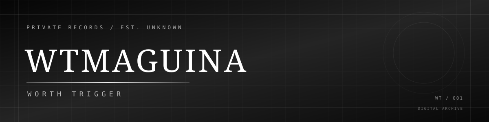

 

 

**W O R T H  T R I G G E R**

`INDEPENDENT DEVELOPER` · `PRIVATE RECORDS`

 

---

### 01 / IDENTIFICATION

<table>
<tr>
<td width="50%" align="center">

**IDENTITY**

WTMAGUINA

</td>
<td width="50%" align="center">

**CLASSIFICATION**

PRIVATE

</td>
</tr>
<tr>
<td width="50%" align="center">

**STATUS**

ACTIVE

</td>
<td width="50%" align="center">

**ESTABLISHED**

UNKNOWN

</td>
</tr>
</table>

### 02 / GITHUB RECORDS

### 03 / ACTIVITY

---

**WT / WORTH TRIGGER**

`PRIVATE ARCHIVES` · `DIGITAL RECORDS`

*Everything leaves a trace.*

